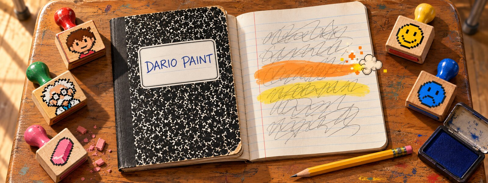
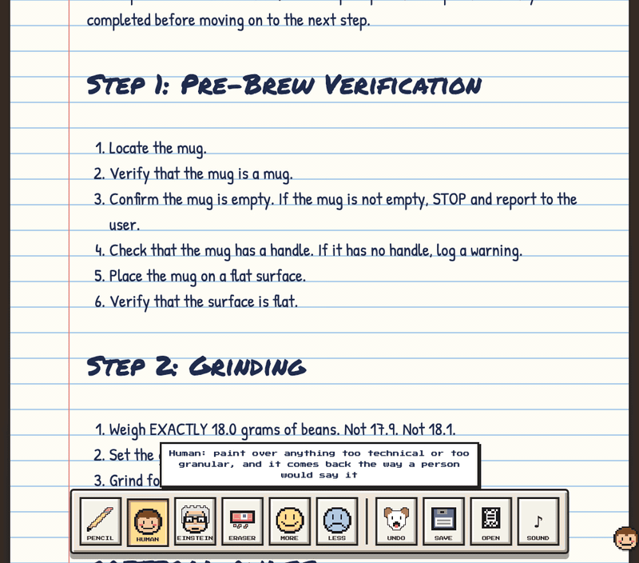
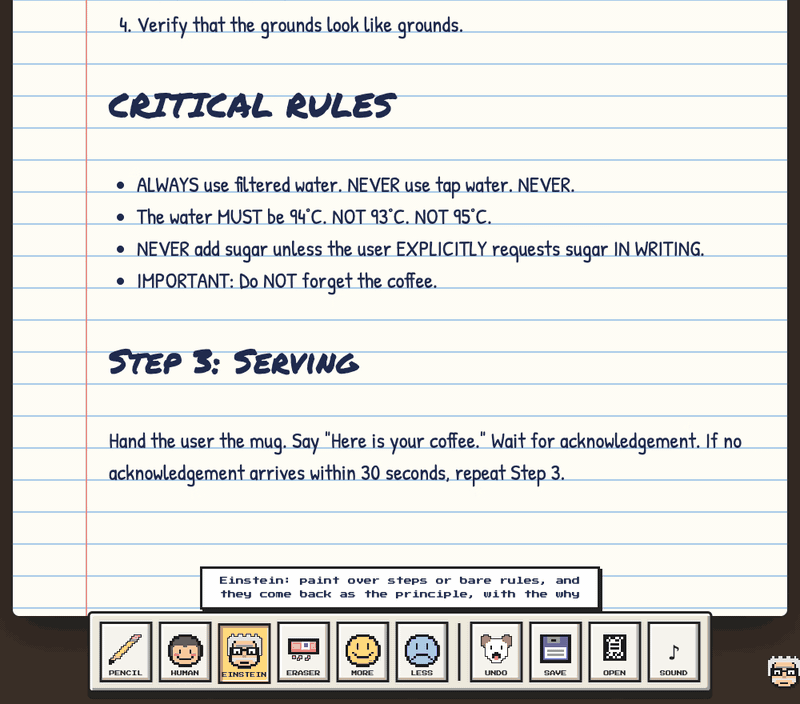
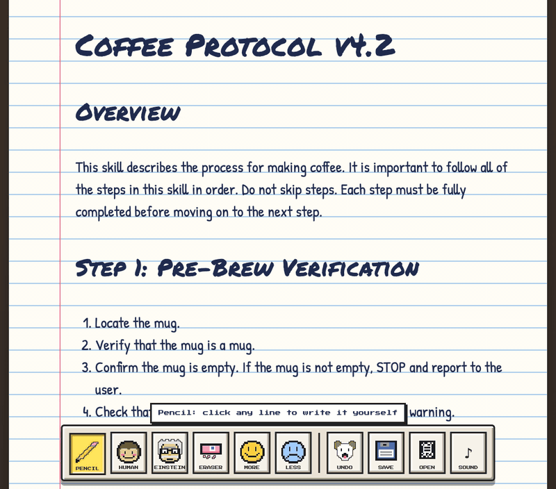
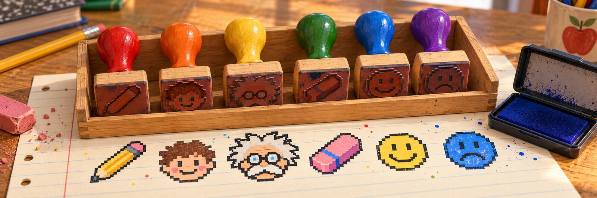
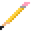
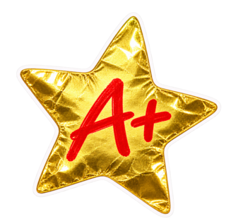

<p align="center">
  
</p>

# Dario Paint

**Your Claude skill is yelling at Claude. Paint over it.**

Somewhere in `~/.claude/skills` there's a file that says `CRITICAL:`. It has numbered steps. One of them is *Verify that the mug is a mug.* Someone wrote it at 2am after Claude did something weird once, and it has been yelling ever since.

The best skills read like a brief from someone who trusts you: here's the goal, here are the edges, here's what good looks like, here's what to avoid and why. The worst explain to a genius how to locate a mug.

Dario Paint opens your skill as big handwriting in a composition book, with rubber stamps straight out of Mario Paint. Pick a stamp, paint over the part that's yelling, and watch it change.

## Show and tell



**Human**, on six steps of mug verification:

> ~~1. Locate the mug. 2. Verify that the mug is a mug. 3. Confirm the mug is empty. If the mug is not empty, STOP and report to the user. 4. Check that the mug has a handle…~~
>
> Find a clean, empty mug and set it somewhere stable. If the mug already has something in it, stop and tell the user rather than pouring over it. A mug without a handle is fine to use, but mention it.



**Einstein**, on the CRITICAL RULES:

> ~~ALWAYS use filtered water. NEVER use tap water. NEVER. … IMPORTANT: Do NOT forget the coffee.~~
>
> Use filtered water: tap water's chlorine and minerals come through as off-flavours. … The point of all this is a cup of coffee the user wants to drink. If something doesn't serve that, it can go.



**Eraser, Less and More**: the intro that says nothing gets rubbed out, *Verify that the mug is a mug* sinks to the bottom of the list to think about what it did, and Step 1 gets promoted.

<sub>We wrote the coffee skill badly on purpose. Mostly. The GIFs skip the thinking: a real rewrite takes about ten seconds, longer for long passages.</sub>

## The stamp box



| | Stamp | Paint over something and… |
| :---: | --- | --- |
|  | **Pencil** | …no, wait. Click a line and write it yourself. |
|  | **Human** | …it comes back in its indoor voice, the way you'd brief a colleague you trust: plainer, shorter, no granular steps. |
|  | **Einstein** | …it comes back as the principle underneath, with the why. He can't hear a rule without asking. |
|  | **Eraser** | …it's gone. Asks no questions. Leaves crumbs. |
|  | **More** | …it matters more. Headings grow, and anything else floats to the top of its section or list. |
|  | **Less** | …it matters less. Headings shrink, and anything else sinks to the bottom. |

 Undo is a dog. It eats your last change; that's the feature.<br>
 Save is a floppy disk. Ask your parents.

Keys 1–6 pick a stamp, ⌘Z (or Ctrl+Z) feeds the dog, ⌘S (or Ctrl+S) saves.

## Judge a book by its cover

Claude does. The cover is the front matter: the skill's NAME and its USE WHEN line (the `description`), which is the only part Claude reads before deciding whether to open the book. Write on the label directly; the counter underneath keeps score.

## School supplies

- [Bun](https://bun.sh)
- [Claude Code](https://claude.com/claude-code), logged in (Human and Einstein need it)
- A skill that's yelling

```sh
git clone https://github.com/Claude-Mem/dario-paint
cd dario-paint
bun install
bun start
```

Open http://127.0.0.1:4848 (or set `PORT`) and pick a skill off the shelf.

**Lunch money.** Human and Einstein call `claude -p` with Opus, so they spend your Claude Code lunch money. The other stamps are free, instant and local; only the handwriting comes from outside, via Google Fonts.

## We don't write in library books

Your installed skills are library books. Opening one copies it into `.scratch/notebooks/`, and every stamp, scribble and save happens on that copy; the original never changes. When you like what you've got, copy the notebook's `SKILL.md` back over the original yourself.

Save won't write a skill with no name or description, for the same reason your teacher wouldn't take homework without a name on it.

The shelf shows every `SKILL.md` in `~/.claude/skills` and `~/.claude/plugins/cache` (the newest copy of each plugin's skills).

## Field trips

Keep skills somewhere else, like a repo? List those folders in `EXTRA_SKILL_FOLDERS`, separated by `:`. Bun reads it from a `.env` file, so that's your permission slip:

```sh
EXTRA_SKILL_FOLDERS=$HOME/code/my-skills
```

If a folder on the list doesn't exist, Dario Paint won't start, and tells you which one. Nobody gets left at the museum.

## Show your work

`bun test` runs the editor against every skill on your machine: each one comes apart and goes back together byte-for-byte, More and Less only move things around, the Eraser removes exactly what you painted, and editing the cover changes only that line. No partial credit.

## Not in this grade yet

- Only `SKILL.md` opens. Scripts and references a skill points to stay where they are.
- You paint whole paragraphs, list items and headings, not half a sentence.

## Gold star

<p align="center">
  <br>
  <a href="LICENSE">MIT</a>. We verified that the license is a license.
</p>
