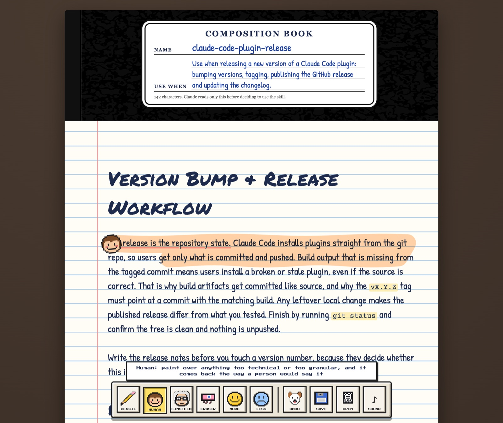

# Dario Paint

Paint over a Claude skill to change it.



A skill is a `SKILL.md`: a little front matter (its name, and the description Claude reads to decide when to use it) and a markdown body that teaches an agent how to do some kind of work. The best skills read like a good brief: the goal, the boundaries, the taste, what good looks like, and what to avoid and why. Many read like a checklist instead (step 1, step 2, ALWAYS, NEVER), which works until the agent meets a case the steps never named.

Dario Paint opens a skill as big handwriting in a composition book and lets you mark it up with rubber stamps, Mario Paint style. Pick a stamp, paint over the part that bothers you, and watch it change.

| Stamp | Paint over something and… |
| --- | --- |
| Pencil | click any line to write it yourself |
| Human | it comes back the way a person would brief a colleague: plainer, shorter, without the granular steps |
| Einstein | it comes back as the principle behind it, with the reason |
| Eraser | it's gone |
| More (smile) | it matters more: headings grow a level, anything else rises to the top of its section or list |
| Less (frown) | it matters less: headings shrink, anything else sinks to the bottom |

The cover is the front matter: write on the NAME and USE WHEN lines directly. The counter under them is there because the description is the only part Claude reads before deciding to use the skill.

Undo is the dog. Keys 1–6 pick a stamp, ⌘/Ctrl+Z undoes, ⌘/Ctrl+S saves.

## Running it

You need [Bun](https://bun.sh), and for the Human and Einstein stamps, [Claude Code](https://claude.com/claude-code) installed and logged in.

```sh
bun install
bun start
```

Then open http://127.0.0.1:4848 (or set `PORT`) and pick a skill off the shelf.

Human and Einstein rewrite through `claude -p` with Opus, so they run on your Claude Code account and take about 15 seconds. The other stamps are instant and nothing you write leaves your machine. The page does load its handwriting fonts from Google Fonts.

## Your originals are never touched

The shelf lists every `SKILL.md` under `~/.claude/skills` and `~/.claude/plugins/cache` (the newest version of each plugin skill). To add other folders, such as a skills repo you're working on, list them in `EXTRA_SKILL_FOLDERS` separated by `:`. Bun reads it from a `.env` file:

```sh
EXTRA_SKILL_FOLDERS=$HOME/code/my-skills
```

Opening a skill copies it into `.scratch/notebooks/`, and every edit and save happens on that copy. Save won't write a file that's missing its name or description. When you're happy with it, copy the notebook's `SKILL.md` back over the original yourself.

Only `SKILL.md` opens for now; any files a skill references are left as they are.

## Tests

`bun test` checks the editor against every skill on your machine: each one splits apart and joins back byte-for-byte, More and Less only move things around, the eraser removes exactly what you painted, and editing the cover changes only that field.

## License

[MIT](LICENSE)
